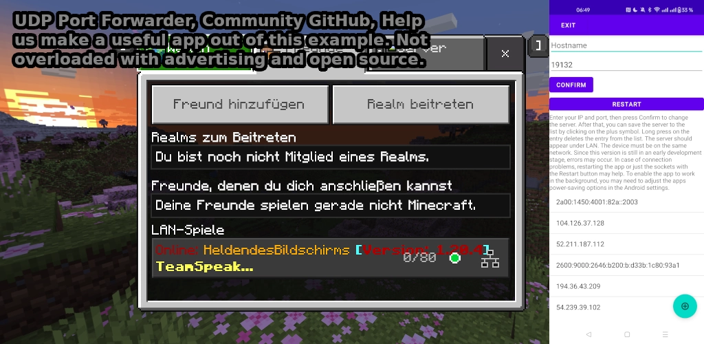

# English

# APP:  
  
https://github.com/JanisPlayer/Minecraft-Bedrock-Connect/tree/master  

# Last Build:  
[app-release.apk](https://github.com/JanisPlayer/Minecraft-Bedrock-Connect/raw/main/app-release.apk)  
PlayStore: [Download](https://play.google.com/store/apps/details?id=de.heldendesbildschirms.mcbedrockconnector) [Why The App Was Renamed](https://github.com/JanisPlayer/Minecraft-Bedrock-Connect/blob/main/Why_The_App_Was_Renamed.md) [PlayStore Availability](https://github.com/JanisPlayer/Minecraft-Bedrock-Connect/blob/main/PlayStore%20Availability.md)  

This project is in no way connected to GKM Interactive or Mojang/Microsoft. It is a purely private, non-commercial open-source project.

# Minecraft-Bedrock-Connect  
An Android app that enables forwarding a server to LAN using packet forwarding.  
This can be useful for consoles like Xbox, PlayStation to connect to external servers.  

# Standard Server  
Permission has been granted by [BedrockConnect](https://github.com/Pugmatt/BedrockConnect/) to use their servers.  
Thanks to this permission, the app requires less maintenance as it is less complex.  

# Useful Information:  
The basic idea of packet forwarding can be tested on Android using UserLAnd:  
```screen -dmS socat socat UDP4-LISTEN:19132,fork,su=nobody UDP4:[164.68.125.80]:19132```  

Protocol:  
- https://wiki.vg/Raknet_Protocol  
- https://wiki.bedrock.dev/  

Proxies:  
- https://github.com/Pugmatt/BedrockConnect/  
- https://github.com/CloudburstMC/Protocol  
- https://github.com/haveachin/infrared  
- https://github.com/cubeworx/cbwxproxy (Docker)  
- https://github.com/cubeworx/cbwxannounce/ (Source)  
- https://github.com/illiteratealliterator/manymine/ (Original)  

Relevant Android networking documentation:  
- https://developer.android.com/reference/java/net/DatagramSocket  
- https://developer.android.com/reference/java/nio/channels/DatagramChannel (Better solution than DatagramSocket)  

Important configurations:  
- `DatagramChannel.configureBlocking(false)`  
- `DatagramChannel.socket().setReceiveBufferSize(MAX_PACKET_SIZE)`  
- `DatagramChannel.socket().setSoTimeout(100)`  
- `DatagramChannel.register(Selector)`  

Example implementation:  
[https://github.com/elixsr/FwdPortForwardingApp/](https://github.com/elixsr/FwdPortForwardingApp/blob/master/app/src/main/java/com/elixsr/portforwarder/forwarding/UdpForwarder.java)  

# How It Works:  
Each Bedrock client sends an Unconnected Ping via the broadcast port using the RakNet protocol.  
This differs from the Java Edition of Minecraft, as no response from the server is required.  
A server bound to `0.0.0.0` can receive these packets.  
The server then redirects the received packets to the target server and relays the responses back to the client.  

## Why Development for Console Fake-LAN Discovery is Paused / Discontinued

The original purpose of **MineProxyLink (MC Bedrock Connector)** was to allow console players (**PlayStation, Xbox**) to join external servers (or server lists like *BedrockConnect*) via a lightweight smartphone proxy that made remote servers appear as **local LAN worlds** under *Worlds -> LAN Games*.

### What Changed in Minecraft: Bedrock Edition (1.26.50 / 1.26.60+)?
Mojang replaced the legacy **RakNet** LAN discovery and connection protocol on UDP port `19132` with **NetherNet** (WebRTC over UDP/DTLS/SCTP):

1. **Encrypted LAN Discovery (UDP Port `7551`):**  
   LAN broadcasts now use `AES-ECB` (`SHA-256(0xdeadbeef)`) + `HMAC-SHA256` encrypted packets on **UDP port `7551`** (`ServerData v7`).
2. **WebRTC HTTP Signaling (TCP Port `19132`):**  
   Dedicated servers now establish connections via HTTP (`GET /v1/join` and `POST /v1/join/{networkId}`) on **TCP port `19132`** before switching to UDP/DTLS/SCTP on port `19132`.
3. **The Cryptographic Blocker (`a=identity` & `TransportIdentityBinding`):**  
   - When joining a server from the **Servers** tab, the Minecraft client fetches a multiplayer JWT from Microsoft (`authorization.franchise.minecraft-services.net`), signs its DTLS fingerprint (`a=fingerprint:sha-256 ...`) with its Xbox session key (`cpk`), and attaches `a=identity:...` to the WebRTC SDP offer.
   - When clicking a world in the **Worlds / LAN Games** tab, the Minecraft client uses LAN signaling (`CONNECTREQUEST` on UDP `7551`) and **omits the `a=identity:` attribute** from the SDP offer.
   - Remote NetherNet servers (*BedrockConnect*, *GeyserMC*, BDS) strictly validate `a=identity:` on `POST /v1/join/{id}` to prevent MITM attacks and reject offers without it with **`HTTP 401 Unauthorized` (`INVALID_IDENTITY`)**. Furthermore, the server later verifies inside the encrypted DTLS session that the player's Xbox login chain is signed by the exact same key (`cpk`) that signed the SDP offer.

### Impact on This Project
Because a passive proxy does not possess the client's private Xbox session key, it cannot forge the `a=identity:` assertion for LAN joins. Supporting Fake-LAN joins to online NetherNet servers now requires terminating the connection and performing a full **Microsoft / Xbox Live OAuth login** inside the proxy app itself. Consequently, active development for login-free console Fake-LAN forwarding is paused/discontinued.

### What Still Works
- **High-Speed Direct Proxy (TCP & UDP Port `19132`):**  
  Adding the smartphone's local IP address and port `19132` in the **Servers** tab (on Windows, Android, iOS) works at full speed thanks to the rewritten non-blocking **Java NIO UDP + TCP proxy engine**.
- **Experimental (Dev) LAN Discovery Bridge:**  
  A developer checkbox in the app (*"Experimental (Dev): NetherNet LAN Discovery Bridge (UDP 7551)"*) is included to test NetherNet LAN discovery (`ServerData v7`) and UDP `7551` -> HTTP `/v1/join` signaling with offline-mode/test servers.

# Deutsch

# APP:  
https://github.com/JanisPlayer/Minecraft-Bedrock-Connect/tree/master

# Last Build:
[app-release.apk](https://github.com/JanisPlayer/Minecraft-Bedrock-Connect/raw/main/app-release.apk)  
PlayStore: [Download](https://play.google.com/store/apps/details?id=de.heldendesbildschirms.mcbedrockconnector) [Warum die App umbenannt wurde](https://github.com/JanisPlayer/Minecraft-Bedrock-Connect/blob/main/Why_The_App_Was_Renamed.md) [PlayStore Verfügbarkeit](https://github.com/JanisPlayer/Minecraft-Bedrock-Connect/blob/main/PlayStore%20Availability.md)  

Dieses Projekt steht in keiner Verbindung zu GKM Interactive oder Mojang/Microsoft. Es handelt sich um ein rein privates, nicht-kommerzielles Open-Source-Projekt.

# Minecraft-Bedrock-Connect
Eine Android App die es ermöglicht einen Server ins LAN weiterzuleiten mit Paket weiterleitung.
Das kann nützlich für Konsolen wie Xbox, Playstation, sein um eine Verbindung zu externen Servern aufzubauen.

# Standard Server  
Die Erlaubnis von [BedrockConnect](https://github.com/Pugmatt/BedrockConnect/) wurde erteilt, die Server mit zu nutzen.  
Dank dieser Erlaubnis ist der Wartungsaufwand der App nicht so hoch, da sie weniger komplex sein muss.

# Nützliche Informationen:  
Grund Idee der Paket weiterleitung, kann unter Android mit Userland getestet werden:  
```screen -dmS socat socat UDP4-LISTEN:19132,fork,su=nobody UDP4:[164.68.125.80]:19132```  
Protocol:  
https://wiki.vg/Raknet_Protocol 
https://wiki.bedrock.dev/  
Proxys:  
https://github.com/Pugmatt/BedrockConnect/  
https://github.com/CloudburstMC/Protocol  
https://github.com/haveachin/infrared  
https://github.com/cubeworx/cbwxproxy (Docker)  
https://github.com/cubeworx/cbwxannounce/ (Source)  
https://github.com/illiteratealliterator/manymine/ (Uhrsprung)  
https://developer.android.com/reference/java/net/DatagramSocket
https://developer.android.com/reference/java/nio/channels/DatagramChannel (Bessere Lösung als DatagramSocket)
Hier ist der DatagramChannel.configureBlocking(false), DatagramChannel.socket().setReceiveBufferSize(MAX_PACKET_SIZE) DatagramChannel.socket().setSoTimeout(100) DatagramChannel.register(Selector) interessant.
[https://github.com/elixsr/FwdPortForwardingApp/](https://github.com/elixsr/FwdPortForwardingApp/blob/master/app/src/main/java/com/elixsr/portforwarder/forwarding/UdpForwarder.java)

# Informationen zu Funktionsweise:
Jeder Bedrock Client sendet über den Broadcast Port einen Unconnected Ping über das Raknet_Protocol, das ist also anderes als wie bei der MC Java Edition und braucht daher keine Nachricht vom Server.
Dieser kann von einem Server der auf 0.0.0.0 gebunden ist empfangen werden.
Der Server adressiert die Empfangenen Pakete um zum Ziel-Server und sendet die vom Ziel-Server empfangen Pakete zurück zum Client.

## Warum die Weiterentwicklung für Konsolen (Fake-LAN) stagniert / pausiert ist

Das ursprüngliche Hauptziel dieser App war es, Spielern auf Konsolen (**PlayStation, Xbox**) über einen einfachen, lokalen Proxy auf dem Smartphone den Beitritt zu beliebigen externen Servern (oder Server-Listen wie *BedrockConnect*) zu ermöglichen – indem der Zielserver im Heimnetzwerk als **lokale LAN-Welt** unter *Welten -> LAN-Spiele* angezeigt wurde.

### Was hat sich in Minecraft: Bedrock Edition (ab 1.26.50 / 1.26.60) geändert?
Mojang hat das jahrelang genutzte, unverschlüsselte **RakNet-LAN-Protokoll** (`Unconnected Ping`/`Pong` auf UDP Port `19132`) durch **NetherNet** (WebRTC über UDP/DTLS/SCTP) ersetzt:

1. **Verschlüsselte LAN-Discovery auf UDP Port `7551`:**  
   LAN-Suchanfragen laufen nicht mehr über Port `19132`, sondern als mit `AES-ECB` (`SHA-256(0xdeadbeef)`) verschlüsselte und per `HMAC-SHA256` signierte Pakete auf **UDP Port `7551`** (`ServerData v7`).
2. **WebRTC-Signaling über TCP Port `19132` (`/v1/join`):**  
   Externe Server nutzen für den Verbindungsaufbau nun HTTP-Signaling (`GET /v1/join` und `POST /v1/join/{networkId}`) auf **TCP Port `19132`**, bevor der eigentliche Spielverkehr über WebRTC/DTLS auf UDP Port `19132` stattfindet.
3. **Das kryptografische Hindernis (`a=identity` / `TransportIdentityBinding`):**  
   - Verbindet man sich über den Reiter **„Server“** (Direktverbindung per IP), holt sich der Minecraft-Client von Microsoft (`authorization.franchise.minecraft-services.net`) ein signiertes Multiplayer-Token (`a=identity:...`), verknüpft es kryptografisch mit seinem WebRTC-DTLS-Zertifikat (`a=fingerprint:sha-256 ...`) und sendet es im SDP-Offer mit.
   - Klickt man hingegen auf einen Eintrag unter **„Welten / LAN-Spiele“**, nutzt Minecraft das lokale LAN-Signaling (`CONNECTREQUEST` auf UDP `7551`) und **sendet kein `a=identity:`-Token im SDP-Offer mit**.
   - Öffentliche NetherNet-Server (wie *BedrockConnect* oder *GeyserMC*) lehnen jedes SDP-Offer ohne gültiges, von Microsoft signiertes `a=identity:`-Token sofort mit **`HTTP 401 Unauthorized` (`INVALID_IDENTITY`)** ab. Zudem prüft der Server später innerhalb des verschlüsselten DTLS-Tunnels, ob die Xbox-Login-Chain mit exakt demselben privaten Schlüssel (`cpk`) signiert wurde wie das `a=identity:`-Token beim Verbindungsaufbau.

### Konsequenz für diese App
Ein reiner Netzwerk-Proxy ohne eigenen **Microsoft-/Xbox-Live-Login** in der App kann das fehlende `a=identity:`-Token für LAN-Verbindungen nicht erzeugen, da er den privaten Xbox-Sitzungsschlüssel des jeweiligen Clients nicht besitzt. Um das Fake-LAN-Feature unter NetherNet wiederherzustellen, müsste die App als vollständiger Bedrock-Server/Client-Endpunkt (inklusive eigenem Microsoft-Account-Login des Nutzers in der App) auftreten.

Aus diesem Grund ist die Weiterentwicklung für das **Fake-LAN-Konsolen-Feature** vorerst eingestellt bzw. pausiert.

### Was weiterhin funktioniert
- **Direkte Server-Weiterleitung (TCP & UDP Port `19132`):**  
  Auf **Windows** und **Smartphones** kann die IP-Adresse des Smartphones (Port `19132`) direkt unter dem Reiter **„Server“** eingetragen werden. Durch die neue, komplett überarbeitete **Java NIO UDP- + Low-Latency TCP-Engine** funktioniert die Weiterleitung über den Server-Tab mit maximaler Geschwindigkeit und unterstützt das neue NetherNet-TCP-Signaling vollständig.
- **Experimentelle Dev-Funktion (Checkbox in der App):**  
  Über die Checkbox *„Experimentell (Dev): NetherNet LAN-Discovery Bridge (UDP 7551)“* kann die Entschlüsselung und Beantwortung der neuen NetherNet-LAN-Pakete (`ServerData v7`) zu Test- und Entwicklungszwecken aktiviert werden (der Zielserver erscheint dann wieder unter *Welten / LAN*, ein Beitritt funktioniert jedoch nur bei Zielservern ohne `a=identity`-Pflicht).
